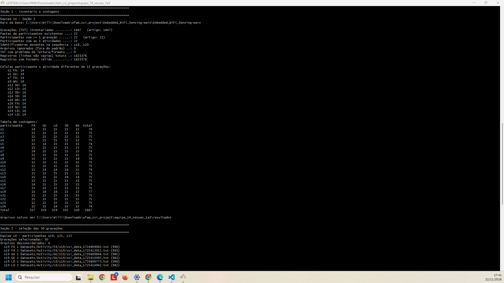
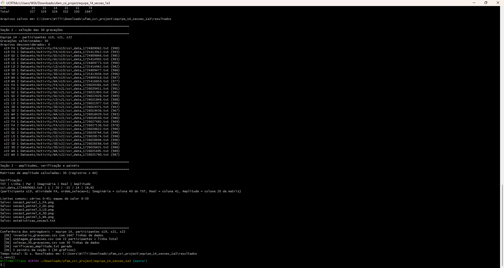

# Trabalho Final – Parte 1 (CSI Wi-Fi) – Equipe 14

Seções 1, 2 e 3 do Trabalho Final – Parte 1, feitas sobre a base pública **Embedded_WiFi_Sensing**
(dados de CSI coletados com ESP32 para reconhecimento de atividades humanas).

- **Equipe 14:** Stephany Castro da Silva e Lahis Gomes de Almeida
- **Participantes da base analisados:** s19, s21 e s22

## Objetivo

- **Seção 1:** fazer o inventário das 1647 gravações da base e montar a tabela de contagens por participante e atividade.
- **Seção 2:** selecionar as 30 gravações da equipe.
- **Seção 3:** calcular as amplitudes de CSI, gerar a tabela de verificação e os 5 painéis (30 gráficos).

Artigo de referência: Armenta-Garcia et al. (2025), *Tools and Methods for Achieving Wi-Fi Sensing
in Embedded Devices*, Sensors 25(19), 6220 – <https://doi.org/10.3390/s25196220>
(cópia em `sensors-25-06220_artigo_base.pdf`).

## ⚠️ A base de dados não está neste repositório

A pasta `Embedded_WiFi_Sensing-main/` está no `.gitignore` porque é grande. Para rodar o código:

1. **Baixe** o ZIP do repositório `Embedded_WiFi_Sensing` (indicado no artigo de referência).
2. **Descompacte** o ZIP na raiz deste repositório, para criar a pasta `Embedded_WiFi_Sensing-main/`.
3. O ZIP cria uma pasta dentro de outra (`Embedded_WiFi_Sensing-main\Embedded_WiFi_Sensing-main`).
   A raiz da base é a **pasta mais interna**, a que contém `Datasets\` e `Scripts\`.
   Configure esse caminho em `equipe_14_secoes_1a3/config.py` (`RAIZ_BASE`) ou na variável de ambiente `RAIZ_BASE_CSI`.

## Estrutura esperada

```text
ufam_csi_project/
├── README.md                                 ← este arquivo
├── .gitignore
├── 1. Trabalho_Final_Parte_1_CSI_v5.pdf      ← enunciado do trabalho
├── sensors-25-06220_artigo_base.pdf          ← artigo de referência
├── utils/                                    ← capturas de tela da execução
│
├── Embedded_WiFi_Sensing-main/               ← BAIXAR E DESCOMPACTAR (não versionada)
│   └── Embedded_WiFi_Sensing-main/           ← raiz da base (usar ESTA em RAIZ_BASE)
│       ├── Datasets/
│       │   ├── Activity/
│       │   │   ├── FA/  s1/ ... s22/  csi_data_*.txt
│       │   │   ├── GU/
│       │   │   ├── LD/
│       │   │   ├── SD/
│       │   │   └── WA/
│       │   └── Breathing(experimental)/
│       ├── Embedded_Model/
│       ├── ESP32_CSI_Web_Collecting_Tool/
│       ├── Scripts/
│       └── README.md
│
└── equipe_14_secoes_1a3/                     ← código e entregáveis da equipe
    ├── LEIA-ME.txt                           ← GUIA COMPLETO DE EXECUÇÃO
    ├── config.py                             ← caminho da base e ID da equipe
    ├── comum.py
    ├── secao1_inventario.py
    ├── secao2_selecao.py
    ├── secao3_amplitudes.py
    ├── executar_secoes_1a3.py                ← roda as seções 1 → 2 → 3
    ├── gerar_relatorio_pdf.py
    ├── requirements.txt
    ├── relatorio.md / relatorio.pdf
    └── resultados/                           ← CSVs, TXTs e figuras gerados
        └── figuras/
```

## Execução rápida (Windows)

```powershell
cd equipe_14_secoes_1a3
python -m venv .venv
.venv\Scripts\python.exe -m pip install -r requirements.txt
$env:RAIZ_BASE_CSI = "C:\caminho\para\Embedded_WiFi_Sensing-main\Embedded_WiFi_Sensing-main"
.venv\Scripts\python.exe executar_secoes_1a3.py
```

## 📘 Guia completo

Versões utilizadas, pré-requisitos, configuração, comandos para Linux/macOS, problemas comuns e a
descrição de cada arquivo gerado estão em
**[equipe_14_secoes_1a3/LEIA-ME.txt](equipe_14_secoes_1a3/LEIA-ME.txt)**.

## ✅ Como o terminal deve ficar numa execução sem problemas

Saída de `executar_secoes_1a3.py` (Git Bash, cerca de 30 s). Confira principalmente:

- **Seção 1:** 1647 gravações e 22 participantes (iguais ao artigo), IDs ausentes `s18, s20`, 0 TXT com problema
  e a tabela de contagens com total **1647**.
- **Seção 2:** 30 gravações selecionadas (2 por participante × atividade) e 0 arquivos desconsiderados.
- **Seção 3:** 30 matrizes de amplitude, a linha de verificação
  (`csi_data_1724809062.txt | 1 | 20 | -25 | 14 | 28,65`) e os 5 painéis salvos.
- **Conferência final:** todos os itens com **`[OK]`**.

**Parte 1 – Seção 1 (inventário e contagens) e início da Seção 2**



**Parte 2 – Seções 2 e 3 e conferência dos entregáveis**


