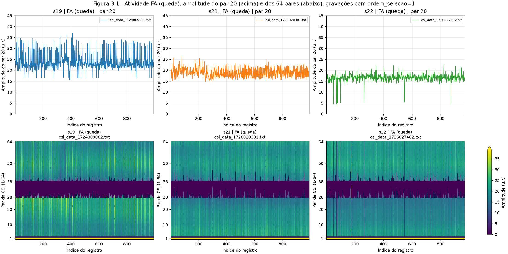
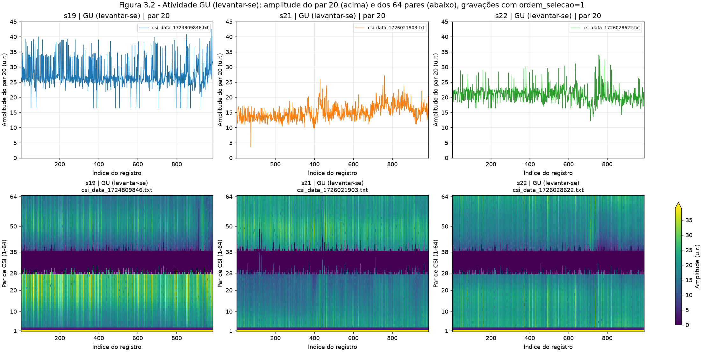
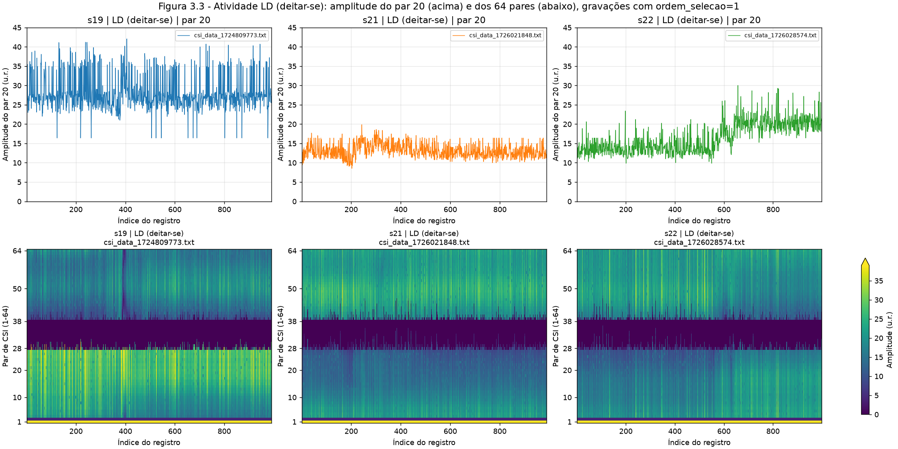
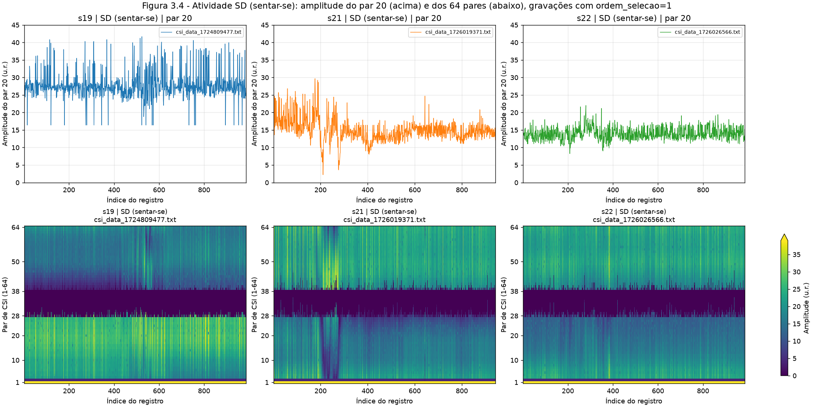
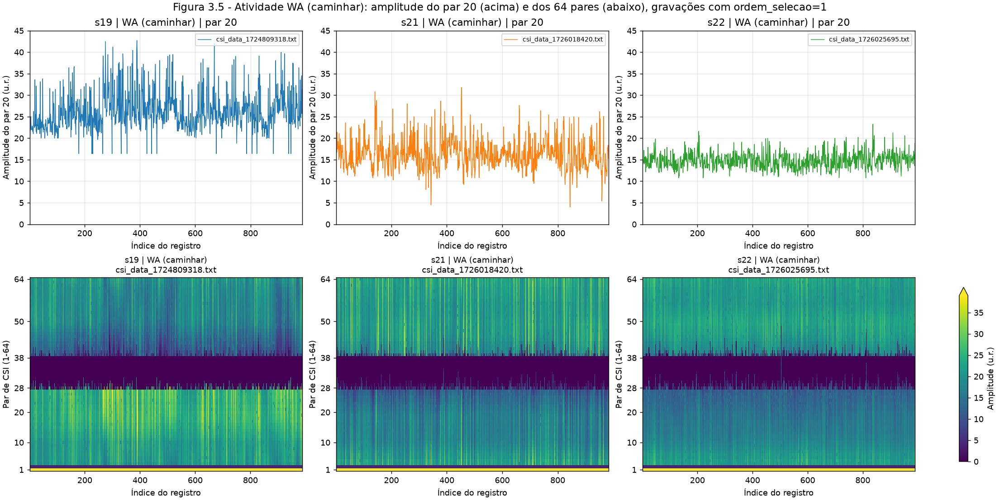

# Trabalho final — Parte 1: seções 1, 2 e 3

**Tópicos em Redes Móveis 2026**

**Equipe 14:** Stephany Castro da Silva; Lahis Gomes de Almeida

**Participantes da base atribuídos:** s19, s21 e s22

## Objetivo

Organizar e verificar as gravações de CSI de cinco atividades humanas: FA (queda), GU (levantar-se), LD (deitar-se), SD (sentar-se) e WA (caminhar). Em seguida, selecionar as 30 gravações da equipe e calcular e visualizar as amplitudes de CSI. A base vem do repositório *Embedded_WiFi_Sensing* e do artigo *Tools and Methods for Achieving Wi-Fi Sensing in Embedded Devices* (Sensors, 2025).

Todos os resultados foram gerados pelos scripts da equipe:

- `secao1_inventario.py`, `secao2_selecao.py` e `secao3_amplitudes.py`, que podem ser executados juntos com `executar_secoes_1a3.py`;
- `config.py` (configuração) e `comum.py` (funções compartilhadas).

As instruções de execução estão em `LEIA-ME.txt`. Os arquivos gerados ficam em `resultados/`.

---

## 1. Organizar e verificar as gravações de atividades

### 1.1 Organização da base

A pasta `Datasets/Activity` contém cinco subpastas, uma por atividade. Cada atividade tem 22 subpastas de participantes (s1 a s24, sem s18 e s20), e cada subpasta guarda os arquivos `csi_data_<timestamp>.txt`. Cada arquivo é **uma gravação**. Cada linha é **um registro de CSI**, ou seja, um pacote Wi-Fi recebido, com 129 valores: 1 valor temporal e 64 pares (imaginária, real).

### 1.2 Inventário das gravações (`resultados/inventario_gravacoes.csv`)

O código percorre as cinco atividades e as subpastas de participantes. Ele grava uma linha por TXT com as colunas `atividade`, `participante`, `caminho_txt`, `total_registros`, `registros_formato_valido` e `problemas_leitura`. Exemplo das primeiras linhas:

| atividade | participante | caminho_txt | total_registros | registros_formato_valido | problemas_leitura |
|---|---|---|---|---|---|
| FA | s1 | Datasets/Activity/FA/s1/csi_data_1720464506.txt | 994 | 994 | nenhum |
| FA | s1 | Datasets/Activity/FA/s1/csi_data_1720464592.txt | 991 | 991 | nenhum |

**Resultado da verificação:**

- **TXT inventariados:** 1.647, ou seja, 1.647 linhas de dados no CSV, sem contar o cabeçalho.
- **Registros:** 1.623.376 linhas não vazias. Todas têm 129 valores numéricos finitos.
- **Problemas:** nenhum arquivo vazio, ilegível ou com linha fora do formato. `problemas_leitura = nenhum` em todos.
- **Registros por gravação:** entre 866 e 1.001. Essa variação é esperada e não é um erro.
- **Conferência:** a linha de exemplo do enunciado, `FA/s1/csi_data_1720464506.txt`, tem 994 registros válidos de 994.

### 1.3 Contagem de gravações por participante e atividade (`resultados/contagem_gravacoes.csv`)

Cada célula informa **quantos arquivos TXT** existem na pasta. Não informa quantos registros há dentro deles.

| Participante | FA | GU | LD | SD | WA | Total |
|---|---|---|---|---|---|---|
| s1 | 14 | 15 | 15 | 15 | 15 | 74 |
| s2 | 15 | 15 | 15 | 15 | 15 | 75 |
| s3 | 15 | 15 | 15 | 15 | 15 | 75 |
| s4 | 15 | 15 | 15 | 15 | 15 | 75 |
| s5 | 15 | 14 | 15 | 15 | 15 | 74 |
| s6 | 15 | 15 | 15 | 15 | 15 | 75 |
| s7 | 14 | 15 | 15 | 15 | 15 | 74 |
| s8 | 15 | 15 | 15 | 15 | 15 | 75 |
| s9 | 15 | 15 | 15 | 15 | 16 | 76 |
| s10 | 15 | 15 | 15 | 15 | 15 | 75 |
| s11 | 15 | 15 | 15 | 15 | 15 | 75 |
| s12 | 15 | 14 | 14 | 16 | 15 | 74 |
| s13 | 15 | 15 | 15 | 15 | 15 | 75 |
| s14 | 15 | 15 | 15 | 16 | 14 | 75 |
| s15 | 15 | 15 | 15 | 15 | 15 | 75 |
| s16 | 14 | 15 | 15 | 15 | 15 | 74 |
| s17 | 15 | 15 | 15 | 15 | 15 | 75 |
| **s19** | 15 | 16 | 16 | 15 | 15 | 77 |
| **s21** | 15 | 15 | 15 | 15 | 15 | 75 |
| **s22** | 15 | 15 | 15 | 15 | 15 | 75 |
| s23 | 15 | 15 | 15 | 15 | 15 | 75 |
| s24 | 15 | 15 | 14 | 15 | 15 | 74 |
| **Total** | **327** | **329** | **329** | **332** | **330** | **1.647** |

**Comparação com o artigo (1.647 gravações e 22 participantes):**

- **Gravações:** o total obtido, 1.647, é igual ao do artigo.
- **Participantes:** existem 22 pastas de participantes em cada atividade, e as 22 têm gravações nas cinco atividades. Não há pasta vazia. O número de pastas existentes e o de participantes com gravações coincidem, e são iguais ao valor do artigo (22).
- **Numeração:** os identificadores vão até s24, mas **s18 e s20 não existem**. Por isso o maior identificador (24) é diferente do número de participantes (22). A lacuna é só de numeração e não indica gravações perdidas.
- **Distribuição:** o protocolo de 15 gravações por célula daria 22 × 5 × 15 = 1.650. Treze células são diferentes de 15:
  - oito têm 14 gravações: s1-FA, s5-GU, s7-FA, s12-GU, s12-LD, s14-WA, s16-FA e s24-LD;
  - cinco têm 16 gravações: s9-WA, s12-SD, s14-SD, s19-GU e s19-LD.

  A conta fecha: 1.650 − 8 + 5 = 1.647. A diferença está na distribuição, não no total.

### Desafios da seção 1 e como foram resolvidos

1. **Gravação × registro.** Para não confundir os dois termos, definimos que gravação é um arquivo TXT e registro é uma linha não vazia. A tabela 1.3 conta arquivos. O inventário conta linhas.
2. **Escopo.** O repositório também tem `Breathing(experimental)`, arquivos NPY, modelos e `CMakeLists.txt`. O código percorre apenas `Datasets/Activity/{FA,GU,LD,SD,WA}` e aceita somente nomes no padrão `csi_data_<números>.txt`. Qualquer outro arquivo seria listado como ignorado. Nenhum foi encontrado.
3. **Ordem dos participantes.** A ordem alfabética coloca s10 antes de s2. Usamos ordenação numérica (função `chave_participante`).
4. **Formato válido.** Linhas vazias não contam como registro. Uma linha válida tem exatamente 129 campos convertíveis em número finito (`float` e `math.isfinite`). Quando há erro, o número da linha e o motivo ficam registrados em `problemas_leitura`.
5. **Falhas de leitura.** A leitura usa `utf-8-sig` (que remove um eventual BOM) e `errors="replace"`, dentro de `try/except`. Assim, um arquivo com defeito é registrado no inventário em vez de interromper a execução.
6. **Diferenças em relação ao artigo.** O código separa pastas existentes, participantes com gravações e participantes com as cinco atividades. Ele também lista os IDs ausentes e as células diferentes de 15 (`resultados/resumo_secao1.txt`).
7. **Portabilidade.** A raiz da base é configurável em `config.py` ou pela variável de ambiente `RAIZ_BASE_CSI`. O `caminho_txt` é gravado relativo à raiz, com separador `/`.

---

## 2. Selecionar as 30 gravações de análise

**ID da equipe:** 14. **Participantes da base:** s19, s21 e s22.

Para cada participante e atividade, o código (`secao2_selecao.py`):

1. pega no inventário os TXT da pasta `Datasets/Activity/<atividade>/<participante>`;
2. ordena os nomes em ordem crescente;
3. escolhe os dois primeiros com `total_registros > 0`, `registros_formato_valido = total_registros` e `problemas_leitura = nenhum`.

**Resultado:**

- `resultados/selecao_30_gravacoes.csv` tem 30 linhas de dados, com as colunas `participante`, `atividade`, `caminho_txt`, `ordem_selecao` e `n_registros`.
- As 30 gravações estão identificadas nesse CSV.

**Arquivos desconsiderados, motivos e substitutos:** nenhum. Os dois primeiros TXT de cada pasta eram válidos, então não houve substituição. O arquivo `resultados/arquivos_desconsiderados.csv` contém só o cabeçalho. Se houvesse descartes, cada linha registraria o arquivo, o motivo e o substituto.

**Observação sobre s19:**

- Os timestamps dos nomes mostram que, em todas as atividades de s19, o **1º TXT foi gravado em 28/08/2024** e os demais em **04/09/2024** (horário UTC).
- Assim, as gravações de ordem 1 e 2 de s19 vêm de sessões de coleta diferentes, com uma semana de intervalo.
- Em s21 e s22, as duas gravações selecionadas são da mesma sessão (11/09/2024), com poucos minutos de diferença.
- Conforme o enunciado, a seleção não foi alterada por causa disso.

---

## 3. Calcular e visualizar as amplitudes de CSI

### 3.2 Cálculo das amplitudes dos 30 arquivos

O código (`secao3_amplitudes.py`, função `amplitudes` em `comum.py`) faz o seguinte para cada linha de cada TXT selecionado:

1. separa a primeira coluna, que é temporal e não entra no cálculo;
2. agrupa os 128 valores restantes em 64 pares (imaginária, real);
3. calcula |H| = √(Re² + Im²).

É a mesma convenção de `get_amps` em `Scripts/CSI.py`. Cada TXT gera uma matriz *registros × 64*. O código confere esse formato contra o `n_registros` da seleção. Por exemplo, s19-FA ordem 1 tem 990 registros e gera uma matriz 990 × 64.

### 3.3 Verificação de uma amplitude (`resultados/verificacao_amplitude.txt`)

| TXT | Linha | Par | Imaginária | Real | Amplitude |
|---|---|---|---|---|---|
| csi_data_1724809062.txt | 1 | 20 | −25 | 14 | 28,65 |

- **Origem:** s19, FA, `ordem_selecao = 1`.
- **Localização:** a imaginária está na coluna 40 do TXT, a real na coluna 41, e a amplitude na coluna 20 da matriz.
- **Conferência:** √(14² + (−25)²) = √821 = 28,65.

### 3.4–3.5 Painéis das 15 gravações de ordem_selecao = 1

São cinco painéis, um por atividade (Figuras 3.1 a 3.5, `resultados/figuras/secao3_painel_<n>_<atividade>.png`). Em cada um:

- na linha superior, as **3 séries temporais** da amplitude do par 20, uma por participante;
- na linha inferior, os **3 mapas de calor** dos 64 pares.

Ao todo são 30 gráficos: 15 séries e 15 mapas. Nos dois tipos, o eixo horizontal é o índice do registro, começando em 1. Os títulos e legendas identificam o participante, a atividade e o TXT.

**Escalas comuns:**

- **Séries temporais:** o eixo vertical vai de 0 a 45 nas 15 séries.
- **Mapas de calor:** a escala de cores vai de 0 a 39 nos 15 mapas. Esse limite é o percentil 99,9 de todas as amplitudes, sem o par 1.
- **Saturação:** o par 1 vale cerca de 115 e é quase constante. Se ele entrasse na escala, os demais pares ficariam com cor praticamente uniforme. Por isso, valores acima de 39 aparecem saturados, o que é indicado pela seta na barra de cores.

### Comentários comparativos

**1. Mesma atividade, pessoas diferentes**

- **Padrão comum:** nas cinco figuras, os três participantes têm a mesma estrutura nos mapas de calor:
  - faixa escura nos pares 28–38;
  - par 1 saturado (amarelo);
  - par 2 escuro;
  - amplitudes moderadas nos pares 3–27 e 39–64.
- **Diferenças de nível:** o nível do par 20 muda bastante entre as pessoas.
  - Figura 3.1 (FA): as médias são 23,99 (s19), 18,88 (s21) e 16,59 (s22).
  - A série de s19 é mais "espinhosa", com picos até 37 e quedas frequentes até 16,4.
  - A de s21 oscila em torno de 19, sem eventos isolados.
  - A de s22 fica em torno de 16,6, com quedas isoladas até cerca de 4–5 nos registros ≈60–100, ≈265, ≈545 e ≈875.
- **s19 nas outras atividades:** nas Figuras 3.2 a 3.5, s19 tem sempre o nível mais alto (médias de 26–28). No mapa de calor, isso aparece como pares 3–27 mais claros que os de s21 e s22.
- **Natureza das quedas de s19:** as quedas recorrentes de s19 até 16,40 correspondem sempre ao mesmo valor bruto (Im = 13, Re = 10). O valor (13, 10) também aparece em s21 e s22, mas lá fica perto do nível médio e não se destaca. Isso indica um valor característico da medição, e não um movimento.

**2. Mesma pessoa, atividades diferentes**

- **s21** é o participante com mais diferença visual entre atividades:
  - FA (Fig. 3.1): estável em torno de 19.
  - GU (Fig. 3.2): sobe aos poucos, com rajadas nos registros ≈400–450 e ≈720–800.
  - LD (Fig. 3.3): estável em torno de 13, com uma pequena elevação em ≈200–300.
  - SD (Fig. 3.4): perturbação forte nos registros ≈180–290, com mínimo de 2,24. Ela aparece em quase todos os pares do mapa: faixa vertical escura nos pares 3–27 e clara nos pares 39–50.
  - WA (Fig. 3.5): flutuação contínua ao longo de toda a gravação.
- **s22:**
  - LD (Fig. 3.3): mudança de patamar perto do registro 600, de ≈14 para ≈20, visível também no mapa.
  - GU (Fig. 3.2): rajada nos registros ≈700–800, com pico de 34.
  - FA, SD e WA: mais estacionárias.
- **s19:** as cinco atividades parecem muito semelhantes entre si (nível alto, picos e quedas recorrentes). Pela inspeção visual, é difícil distingui-las.

**3. Variação durante a gravação**

Os valores abaixo são o desvio padrão do par 20 em janelas de 100 registros (`resultados/estatisticas_secao3.txt`).

| Gravação | Trecho de maior variação | Trecho de menor variação |
|---|---|---|
| s21-SD | 201–300 (dp 4,64) | 701–800 (dp 1,70) |
| s21-GU | 401–500 (dp 3,04) | 101–200 (dp 1,16) |
| s22-GU | 701–800 (dp 4,43) | 201–300 (dp 1,77) |
| s22-FA | 1–100 (dp 2,83, devido às quedas isoladas) | 601–700 (dp 1,03) |
| s22-LD | 601–700 (dp 3,09, transição de patamar) | 1–100 (dp 1,77) |

Nas gravações de s19, a variação é alta e parecida em todas as janelas (dp entre 2,7 e 5,4). Sem anotação, não identificamos o instante exato da queda. Os trechos citados são só os de maior variação de amplitude.

**4. Comportamento dos pares** (15 gravações juntas)

- **Par 1:** média ≈115,3 e desvio padrão de 0,91. É praticamente constante e muito acima dos demais pares.
- **Par 2:** média ≈4,0 e desvio padrão de 0,04. Também é constante.
- **Pares 30–38:** média abaixo de 1, ou seja, próxima de zero.
- **Pares 28 e 29:** médias de 5,6 e 2,3, uma transição para a faixa nula.
- **Coincidência com os autores:** essas posições (pares 1 e 28–38) são as que os autores excluem como subportadoras nulas (`nulls = [0, 27, …, 37]` em `Scripts/imf_generator.py`, índices a partir de 0).
- **Pares 3–27 e 39–64:** amplitudes úteis, de 17 a 21 em média.
  - Os pares das bordas da faixa nula variam mais: 25–27 e 39–41, com dp entre 6,1 e 7,9.
  - Os pares das extremidades variam menos: 3–10 e 53–61, com dp entre 3,2 e 3,7.

---

## Conclusões e limitações (seções 1 a 3)

- **Base:** os dados estão íntegros. São 1.647 gravações de 22 participantes, todas no formato correto, o que confere com o artigo.
- **Seleção:** as 30 gravações da equipe foram escolhidas sem nenhum descarte.
- **Pares sem informação:** os pares 1, 2 e 28–38 são constantes ou nulos e não trazem informação útil.
- **Variabilidade:** no par 20, as diferenças de nível entre participantes e entre sessões (s19) são mais visíveis que as diferenças entre atividades.
- **Limitações:**
  - a análise visual cobre um único par e uma gravação por participante e atividade;
  - não há anotação do instante dos movimentos;
  - as conclusões valem só para as 15 gravações representadas nos painéis.

## Referências

1. Artigo fornecido pelo professor: *Tools and Methods for Achieving Wi-Fi Sensing in Embedded Devices*. Sensors, v. 25, n. 19, art. 6220, 2025. https://www.mdpi.com/1424-8220/25/19/6220
2. Repositório *Embedded_WiFi_Sensing* (arquivo `Embedded_WiFi_Sensing-main.zip` fornecido pelo professor): `Datasets/Activity` e `Scripts/CSI.py`, função `get_amps`, usada como referência para o cálculo das amplitudes.
